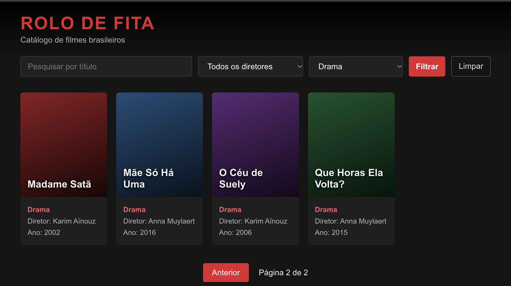

# Rolo de Fita

Aplicação em Django para consultar um catálogo de filmes brasileiros.

## Dupla 14
- José Fernandes Figueiredo Filho
- Anderson Cauã

## Tema
Catálogo de Filmes, com os modelos Filme, Diretor e Categoria.

## Filtros implementados
- Pesquisa por título (parâmetro `busca`): usa `titulo__icontains`.
- Diretor (parâmetro `diretor`): lista `<select>`.
- Categoria (parâmetro `categoria`): lista `<select>`.

Os filtros usam GET, funcionam sozinhos ou combinados e são aplicados antes da paginação.

## Paginação
Usa `Paginator`, com 5 filmes por página. Mostra a página atual, o total e os links Anterior e Próxima, preservando a pesquisa e os filtros.

## Como executar
```
git clone https://github.com/kauannfy/Catalogo_Filmes.git
cd Catalogo_Filmes
python3 -m venv venv
source venv/bin/activate
pip install -r requirements.txt
python manage.py migrate
python manage.py loaddata dados
python manage.py runserver
```
No Windows, use `py -m venv venv` e `venv\Scripts\activate`.

## Captura de tela

